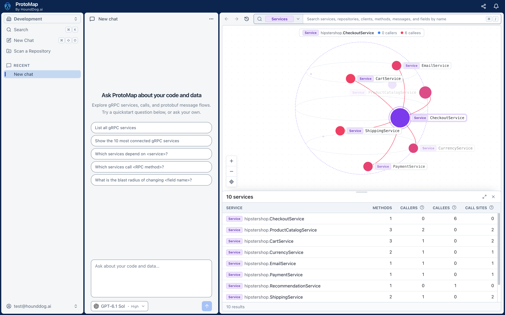
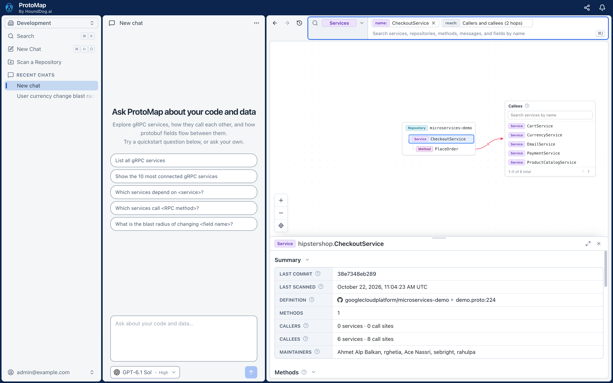
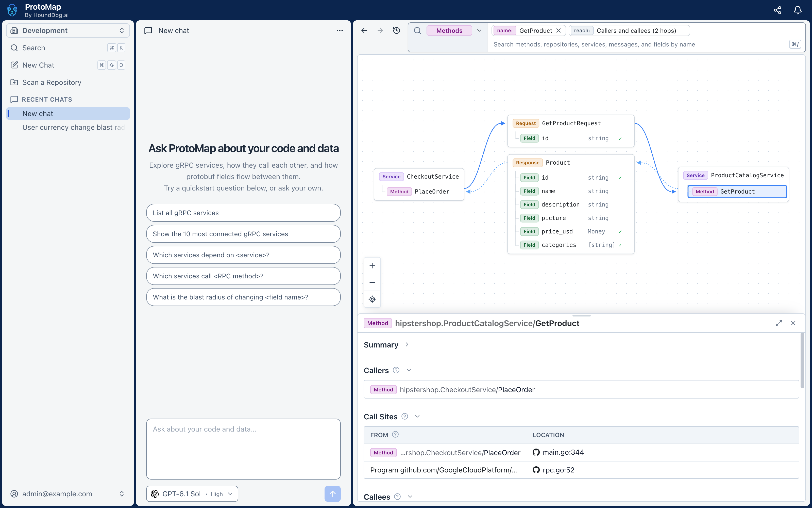

# ProtoMap

ProtoMap by HoundDog.ai maps your gRPC services: which services call which, through which methods and protobuf fields,
down to every call site. Run it on your own infrastructure, explore your architecture in its platform, ask its assistant
what a change would break, and give the same graph to coding agents such as Claude Code.



## What you can do

- **See your architecture.** Every gRPC service defined across your repositories, in monorepos or across microservices,
  and how they connect, by repository, service, method, message, and field.
- **Assess the blast radius of a change.** Before you change a service, method, or field, see the services, consumers,
  and call sites it affects.
- **Find every call site of an RPC.** Which services call a method, in which file and function, and the call itself.
- **Trace how a field flows.** Follow a protobuf field through the code step by step, from one service into the next.
- **Ask the assistant.** It answers from your scans, with file locations, and draws diagrams, using the AI provider you
  connect.
- **Give coding agents the graph.** Over MCP, including your uncommitted changes.

ProtoMap reads `.proto` files and the gRPC code that serves and calls them in Go, C#, Java, JavaScript, Kotlin, Python,
Rust, Swift, and TypeScript.





## Install ProtoMap Server

```shell
git clone https://github.com/hounddogai/protomap
cd protomap
./server/scripts/install.sh
```

Open the address the installer prints, enter the one-time setup key it prints, and create your organization and its
owner. Setup then connects an AI provider for the assistant, such as Anthropic or OpenAI, with your own API key. The
installer also installs the CLI on its computer. [`server/README.md`](server/README.md) covers the requirements,
options, configuration, upgrades, and uninstalling.

## Install the CLI

On macOS or Linux:

```shell
curl -fsSL https://protomap.ai/install.sh | sh
```

On Windows, in PowerShell:

```powershell
irm https://protomap.ai/install.ps1 | iex
```

The scripts install the latest [release](https://github.com/hounddogai/protomap/releases) after checking it against its
`SHA256SUMS`, and add its folder to your `PATH`: `~/.local/bin` on macOS and Linux, and `%LOCALAPPDATA%\protomap\bin` on
Windows, or `%ProgramFiles%\protomap\bin` for all users when run as an administrator. `PROTOMAP_INSTALL_DIR` names
another folder. The Linux builds are static and run on any Linux, Alpine included.

The CLI updates itself. At most once a day, a command downloads any newer release in the background, and the next
command uses it. It does not update itself in CI, in containers, or when installed for all users, by root or a Windows
administrator. Run `protomap update` to update now, `protomap update --auto off` or `--auto on` to turn automatic
updates off or on, and `protomap update --rollback` to go back to the version an update replaced.
`PROTOMAP_DISABLE_AUTOUPDATE=1` turns automatic updates off for one command or a whole environment.

## Scan your repositories

Log in to your server, then scan a repository:

```shell
protomap login --server=http://<your server>:3300
protomap scan /path/to/repository
```

`protomap login` opens ProtoMap in your browser so you can approve the login. The link works only once, so if another
browser opens it first, such as another user's on the same computer, the login is refused and you need to run the
command again. Without a browser, such as over SSH, or with `--no-open`, it prints a code to enter at
`http://<your server>:3300/#/cli` on any computer. Afterward, check that it logged you in to the right account.
`protomap logout` forgets the server and revokes this computer's key on it.

A scan of a pushed commit on the primary branch, with no uncommitted changes, joins the graph everyone in your
organization sees. A repository's first scan joins it too, whatever its branch or changes, until such a scan replaces
it, unless the repository has no remote. Your other scans, such as of uncommitted changes or other branches, are visible
only to you. After it uploads, each scan says which kind it is.

`--no-upload` shows what a scan finds without a server or a login: it uploads nothing, contacts no server, and skips
the update check. `--json` prints the result as JSON.

ProtoMap finds gRPC code through the `.proto` files that define it. When a repository uses an API whose `.proto` files
live elsewhere, such as in another repository or where its build downloads them, name each folder with `--proto-path`:

```shell
protomap scan --proto-path /path/to/api /path/to/repository
```

The repository's later scans, and `protomap mcp serve`, read the same folders until `--proto-path` names others or
`--no-proto-paths` forgets them. A scan that uploads also reads the `.proto` files of your organization's other scanned
repositories, so an API defined in one of them needs no flag. `--no-shared-definitions` skips them. Either way, the
repository's own `.proto` files take priority.

## Connect a coding agent

Add the CLI to your coding agent as an MCP server. While the agent runs, the CLI scans the repository it works in as
files are saved, and uploads those scans, so the agent sees the graph with your latest changes. For Claude Code, in
every repository:

```shell
claude mcp add -s user protomap -- protomap mcp serve
```

To add it to one repository only, run the command from the repository's folder without `-s user`. For Antigravity:

```shell
agy mcp add protomap protomap mcp serve
```

**Scan a Repository** in the platform's sidebar gives the command for Codex, Gemini CLI, Copilot CLI, VS Code, OpenCode,
Amp, Droid, and Qwen Code, and the JSON for other agents, which run `protomap mcp serve` over standard input and output.
The agent reads the graph as you, so log in first, or use a personal API key.

## Containers, CI, and other automation

Instead of logging in, set `PROTOMAP_URL` to your server and `PROTOMAP_API_KEY` to an API key from the platform's
**Settings › API Keys**:

```shell
export PROTOMAP_URL=http://<your server>:3300 PROTOMAP_API_KEY=<key>
protomap scan /path/to/repository
```

A personal key acts as you, and also works with `protomap mcp serve`. An organization key, which admins create for
continuous integration, scans without a user and cannot be used with `protomap mcp serve`. Its scans exist only to keep
your organization's graph current, so a scan the server would not add to it, such as of a branch other than the primary
one, fails with the reason, unless the graph already has a newer commit.
