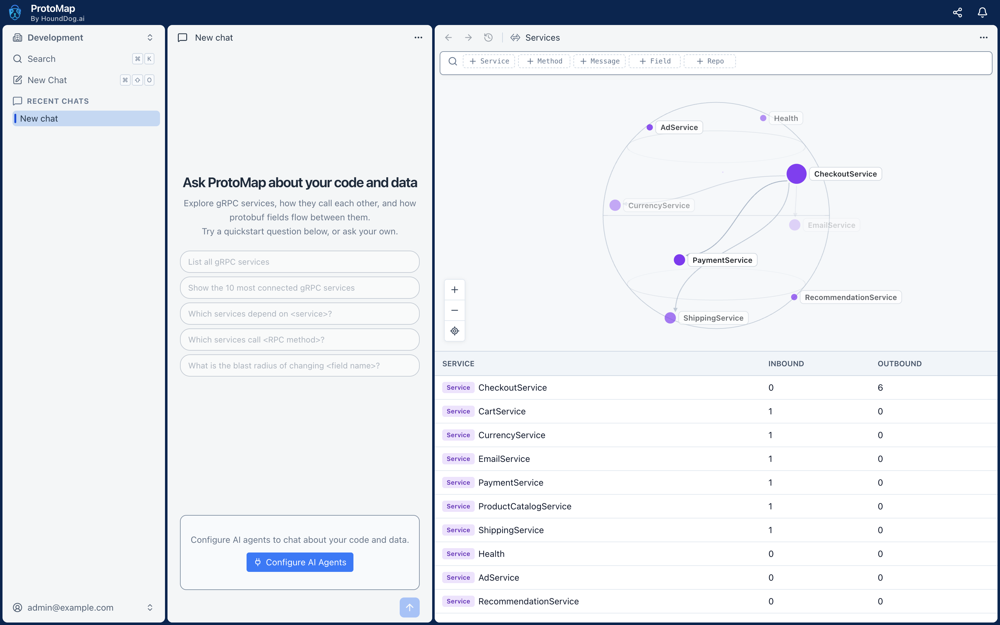

# ProtoMap Self-Hosted

Run ProtoMap in your own environment.



## Requirements

- Docker with Compose 2.23.1 or newer
- At least 4 GB of RAM and 20 GB of disk space

## Installation

```shell
git clone https://github.com/hounddogai/protomap.git
cd protomap/self-hosted
./scripts/install.sh
```

The installer will ask you to choose the installation type:

1. **Trial:** The quickest way to try ProtoMap. PostgreSQL is set up locally for you.
2. **Production:** Connects ProtoMap to your own PostgreSQL 18 database. This option requires more setup and
   maintenance.

When the installation finishes:

1. Open the ProtoMap URL printed by the installer, such as `http://localhost:3300`, or this computer's address from
   another computer.
2. Enter the one-time setup key printed by the installer.
3. Create your organization and owner account.

The installer also installs the ProtoMap CLI. In Trial mode, it logs the CLI in as the owner, so you can scan a
repository right away:

```shell
protomap scan /path/to/repository
```

To install the CLI on other computers and connect coding agents, see the [main README](../README.md).

## Configuration

The installer writes your settings to `.env`, and [`.env.example`](.env.example) explains every setting. After you
change `.env`, apply it with `docker compose up -d`.

Back up `.env` along with your database. Its `PROTOMAP_SECRET_KEY` encrypts the AI provider API keys that ProtoMap
stores, which cannot be read without it.

By default, ProtoMap is reachable from other machines on your network over plain HTTP. For anything but a trial, put a
proxy that serves HTTPS in front of it, and set `PROTOMAP_BIND_ADDRESS=127.0.0.1` so that only the proxy can reach it.

## Upgrade

Upgrading keeps your configuration and data, and also upgrades the CLI. Back up your database first, because ProtoMap
is briefly unavailable while the upgrade runs.

```shell
git pull && ./scripts/upgrade.sh
```

ProtoMap runs the latest release unless `PROTOMAP_VERSION` in `.env` names another, such as `1.2.3`. If the upgrade
fails, the previous version starts again. Fix the reported error and run `./scripts/upgrade.sh` again.

The upgrade refuses a release older than the one running. To go back to one, restore the database backup made before
upgrading from it, set `PROTOMAP_VERSION` in `.env` to that release, then run `docker compose down` and
`./scripts/upgrade.sh`.

## Uninstall

Uninstall removes ProtoMap and its data. It keeps the CLI, configuration backups, this directory, and your own
PostgreSQL database.

```shell
./scripts/uninstall.sh
```

To start over with a fresh installation, uninstall, then run `./scripts/install.sh` again. With your own PostgreSQL,
use a new or empty database.
