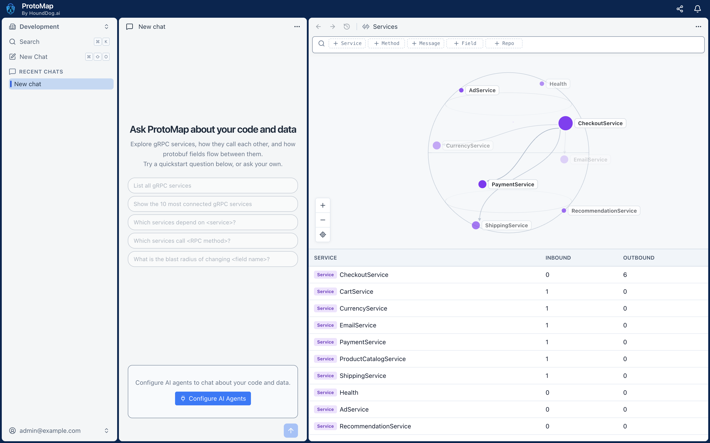

# ProtoMap Self-Hosted

Run ProtoMap in your own environment.



## Requirements

- Docker with Compose 2.23.1 or newer
- At least 4 GB of RAM and 20 GB of disk space

## Installation

```shell
git clone https://github.com/hounddogai/protomap.git
cd protomap/self-hosted
./install.sh
```

The installer will ask you to choose the installation type:

1. **Trial:** The quickest way to try ProtoMap. PostgreSQL is set up locally for you.
2. **Production:** Connects ProtoMap to your own PostgreSQL 18 database. This option requires more setup and
   maintenance.

When the installation finishes:

1. Open the ProtoMap URL printed by the installer, such as `http://localhost:3300`, or this computer's address from
   another computer.
2. Enter the one-time setup key printed by the installer.
3. Create your organization and owner account.

The installer also installs the ProtoMap CLI. In Trial mode, it logs the CLI in as the owner, so you can scan a
repository right away:

```shell
protomap scan /path/to/repository
```

By default, ProtoMap is reachable from other machines on your network over plain HTTP. For anything but a trial, put a
proxy that serves HTTPS in front of it, set `PROTOMAP_BIND_ADDRESS=127.0.0.1` in `.env`, and run `docker compose up -d`.

## Upgrade

Upgrading keeps your configuration and data, and also upgrades the CLI. Back up your database first, because ProtoMap
is briefly unavailable while the upgrade runs.

```shell
git pull && ./upgrade.sh
```

If the upgrade fails, the previous version starts again. Fix the reported error and run `./upgrade.sh` again.

## Reset

Reset deletes your installation and its data, then starts a fresh installation. It does not delete data in your own
PostgreSQL database.

```shell
./reset.sh
```

## Uninstall

Uninstall removes ProtoMap and its data. It keeps the CLI, configuration backups, this directory, and your own
PostgreSQL database.

```shell
./uninstall.sh
```

## More

[`OPERATIONS.md`](OPERATIONS.md) covers scaling, accounts, API keys, the CLI on other computers, coding agents, and AI
providers.
